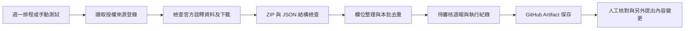

# 每週旅遊情報待審稿｜GitHub Actions 示範

建立日期：2026-10-19。**本地測試已完成，現依使用者授權進行 GitHub 手動執行驗證；實際結果見驗收紀錄，週一 schedule 投遞仍待另驗證。** 不自動呼叫 AI、不寫回網站、不建立 PR、不發布內容。這次另保留本地成功及失敗紀錄，見 [驗收紀錄](GITHUB-ACTIONS-TEST-REPORT.md)。

## 排程與權限

工作流程：[travel-weekly-review.yml](../.github/workflows/travel-weekly-review.yml)。

```yaml
schedule:
  - cron: '0 1 * * 1' # 週一 UTC 01:00 = Asia/Taipei 09:00
```

採 UTC 換算，台北為 UTC+8；runner 的 `TZ` 只影響程式環境，不會改寫 cron。另有 `workflow_dispatch`，預設 `fixture` 離線測試，可手選 `live`。真正的 schedule 事件固定選 live。工作流程不設定 push 觸發。

排程檔需存在預設分支，才具備排程觸發條件；不保證準點，繁忙時可能延遲或掉隊。公開儲存庫長期無活動也可能停用排程，目前官方規則為 60 天。未觀察到一次 event=schedule 的實際執行前，排程投遞仍是未驗證。見 [GitHub schedule 文件](https://docs.github.com/en/actions/reference/workflows-and-actions/events-that-trigger-workflows#schedule)。

使用標準 `ubuntu-24.04` runner、系統 `python3`、標準函式庫，不安裝套件；10 分鐘工作上限，不取消正在執行的同類工作。官方 checkout／upload-artifact 固定至本次查得的完整發行 SHA；未來升版需另驗證，不將浮動 main 當依賴。

`permissions: contents: read`，checkout 不保存 Git 憑證。沒有寫入程式庫、Pages、Vercel、名單或帳號的步驟。GitHub artifact 保存 14 天，成功和失敗都嘗試保存紀錄。公開儲存庫的紀錄／審稿產物不能視為秘密儲存空間；本例只處理公開景點資料與明示測試資料。

## 允許擷取的公開來源

來源登錄：[sources.json](../automation/travel-weekly/sources.json)。

- 交通部觀光署「景點－觀光資訊資料庫」：[官方資料集 7777](https://data.gov.tw/dataset/7777)。本次頁面列有免費、政府資料開放授權條款第 1 版及現行下載連結。
- 現行公開資源：[Attraction-json.zip](https://media.taiwan.net.tw/XMLReleaseAll_public/v2.0/Zh_tw/Attraction-json.zip)，只讀其中 `AttractionList.json`，不解壓寫入任意路徑，也不使用舊版 scenic_spot 端點。
- 依 [政府資料開放授權條款](https://data.gov.tw/license) 保留提供機關、年度、資料集、授權連結與本次擷取時間；不宣稱政府推薦本旅行社。

這是下載明示授權的資料資源，不是任意爬取旅遊網站。每次 live 先確認詮釋資料頁仍有預期授權、免費文字與下載連結，再抓固定白名單 HTTPS 資源。來源改版／授權文字消失／連結改變需人工重審設定。來源的個別 WebsiteURL 僅檢查 URL 語法，不逐一抓取、更不據此宣稱現場營運已核對。

首次格式探查曾成功下載約 3.1 MB 的 ZIP；後續完整 live 測試遇到來源站回覆「Request Rejected」HTML，已失敗停止。公開授權不代表來源站保證任何網路環境都能取得；**不得改 IP、偽裝瀏覽器或繞過封鎖**。可先用 fixture 驗證流程、等待來源恢復，或經確認後改用另一個明示授權的官方資料集並重寫對應測試。

## 流程與資料界線



Python 程式：[collect_weekly.py](../automation/travel-weekly/collect_weekly.py)。模式明確分離：

| 模式 | 網路／資料 | 可聲稱的結果 |
|---|---|---|
| fixture | 全部使用 `fixtures/attractions.json`，不連網 | 離線管線測試；每筆 is_mock=true、來源為 null，不是旅遊研究成果 |
| live | 授權詮釋資料 + 公開 ZIP | 成功時代表機器取得與整理資料；內容仍 pending_review，非逐筆營運查證 |

不以 fixture 自動接替失敗的 live。重試最多一次；403／404／來源拒絕頁或不符格式直接失敗，429／部分 5xx／連線問題可有限重試。若 Retry-After 要求較長等待，停止等候後續人工或排程處理。單次 HTTP timeout 40 秒，下載上限 20 MB，JSON 解壓上限 32 MB。

保留景點 ID、名稱、地區、最多 180 字來源摘錄、來源更新時間與本次擷取時間。來源更新時間與本次查詢時間不互相替代。價格、開放時間、交通班次與活動日期一律不從文字猜測，欄位為 null；此版本不下載活動資料，若要擴充活動須另建來源及日期驗證。描述可能含過時營運說法，草稿視為待查原文摘錄，必須再審。

去重範圍為**本次資料批次**：相同 ID，或完整相同「正規化名稱＋縣市＋非空街道地址」才合併。保留來源更新時間較新者，同分以內容 SHA／ID 決定穩定順序；衝突與被排除筆記錄於 quality.json。不同景點共用官網首頁不構成重複。沒有跨次 baseline，因此不能宣稱比上週新增了多少、也不是增量監測。

週報固定取去重後 ID 排序的前 9 筆；不足時保留實際筆數，不造資料。這是審稿樣本，不是最佳旅遊行程或符合三類客群的自動判斷。親子、情侶、熟齡分類與具體行銷文案由人員再編輯；模板提供切入點、FAQ 及核對清單。

## 輸出與失敗紀錄

| 檔案 | 用途 |
|---|---|
| `weekly-report.pending.md` | 明確待審稿、來源署名、景點候選、模板 FAQ／切入點及人工核對清單 |
| `candidates.json` | 去重後完整候選，含來源、模式與 pending_review 標記 |
| `quality.json` | 重複原因、衝突、無效筆及不足目標等警告 |
| `sources.md` | 實際來源檢查範圍與未驗證事項；fixture 另標無官方來源 |
| `events.ndjson` | UTC 時間、HTTP 狀態、位元組、SHA、重試及失敗階段，不保存金鑰或原始網頁指令 |
| `run-summary.json` | 模式、事件、時區、計數、來源檢查、草稿／AI／網站／發布的分開狀態 |

GitHub 寫到 `review-output/` 再上傳 artifact；該目錄已被 `.gitignore` 排除。程式拒絕覆寫非空輸出，並拒絕將輸出寫進 `site/`、`research/`、`docs/`、影片、技能、工作流程或程式目錄；每次本地測試使用新目錄。來源取得／格式失敗時 exit 1，保留 blocked 紀錄，不產生成功週報。若在 checkout／測試階段失敗、尚未啟動 collector，job summary 會說明沒有 collector 紀錄，原生 Actions log 仍可檢查。

`status=success` 只代表整理管線完成。`ai_call=not_used`、`website_update=not_attempted`、`publication=not_attempted` 各自記錄。沒有任何核准欄位或變更草稿名稱就自動發布的捷徑。

## 本地測試

在專案根目錄 PowerShell 執行（本機已有 Python 3.12）：

```powershell
py -3.12 -X utf8 -m unittest discover -s automation/travel-weekly/tests -v
py -3.12 -X utf8 automation/travel-weekly/collect_weekly.py --mode fixture --output .build/actions-demo/class-fixture-01
```

預期 fixture：原始 6、有效去重後 3、重複 2、無效排除 1；週報清楚標為模擬。第二次請改輸出目錄名稱，不覆寫第一次紀錄。

需要測試 live 且來源允許連線時才執行：

```powershell
py -3.12 -X utf8 automation/travel-weekly/collect_weekly.py --mode live --output .build/actions-demo/class-live-01
```

若來源仍拒絕，預期 exit 1／blocked，這是正確的失敗處理，不代表資料內容品質已通過。不要把原始 fixture 案例改名成 live 紀錄。

## GitHub 分層驗收與人工審核

初版只產出排程與紀錄；現依使用者授權執行 GitHub 手動測試。完整驗收步驟：

1. 檢查差異，只加入本次工作流程、automation 程式與文件，不把尚未提交的其他技能變更順便加入。
2. 經授權 Commit／push 至 `ian09270927/travel-ai-agent` 的預設分支。檔案只放在本機不會啟用 GitHub 排程。
3. Actions → **Travel weekly review draft** → Run workflow → mode=`fixture`。確認工作狀態、job summary、artifact 與明示模擬內容。手動成功不是排程投遞成功。
4. 再手動 mode=`live`，確認來源狀態及資料內容；目前 WAF 狀態可能仍造成失敗，不能用排程成功來保證下載可用。
5. 啟用後觀察下一個實際週一事件；以 2026-10-19 為基準，下一個預定時點為 **2026-10-26 09:00 Asia/Taipei**。需有 event=schedule、run URL、實際開始時間與紀錄；無觸發時檢查預設分支、workflow 啟用狀態、長期無活動及平台延遲。
6. 審稿人下載 artifact，逐筆核對來源、重複衝突、現況與客群限制；另以人工內容變更／PR 送審，通過後才由獨立、已授權的網站更新流程套用。這個 workflow 永遠不負責部署。

## AI 與費用

目前完全不用 AI API 或 API Key。替代方案是確定性的 Python 整理與模板，再由人員編輯，或下載後在互動式 Codex 中使用 `travel-content-factory` 審查。GitHub runner 不會因為你已登入桌面 Codex 就自動取得相同帳號、工具或模型額度。

日後若要加入 AI，需另行評估供應商、資料傳輸、可用模型、API 權限、費用及速率限制；用 GitHub Actions Secrets 保存正式授權的金鑰並獨立驗收真實呼叫，不能把 Actions 的 GITHUB_TOKEN 當模型 Key。本範例沒有呼叫任何 AI，也沒有為此新增 secret。

公開 Repository 使用標準 GitHub-hosted runner 的執行時間目前免費，但 artifact／儲存用量仍受帳號與設定限制，不能把這份設計當成不限額成本保證；本次採 14 天保存且不使用 larger runner。詳見 [GitHub Actions 計費文件](https://docs.github.com/en/billing/concepts/product-billing/github-actions)。
